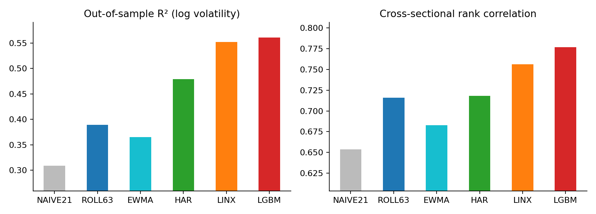
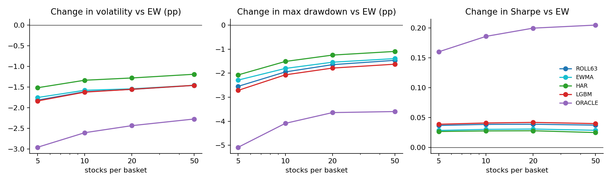
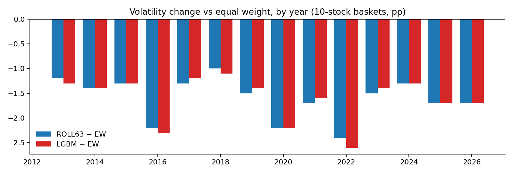
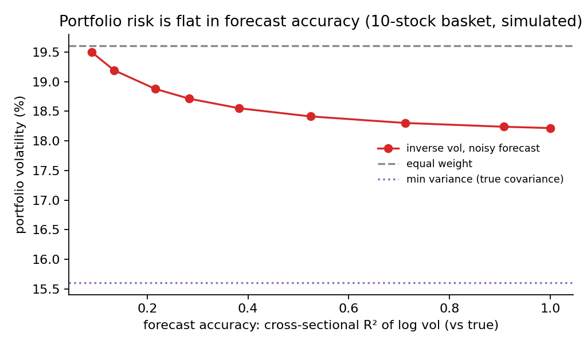
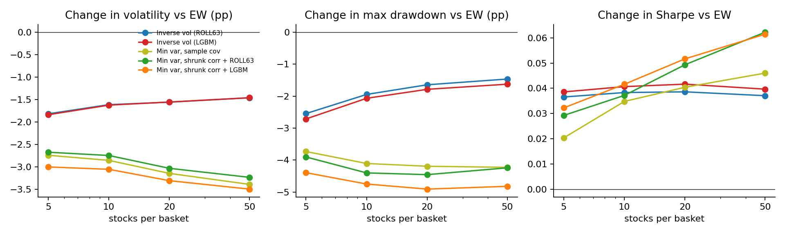
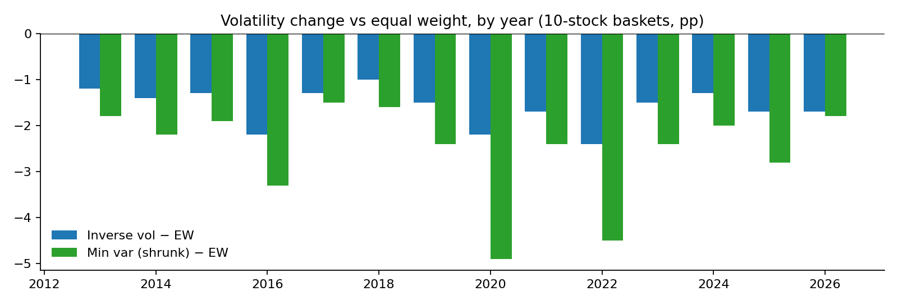

# Does better volatility forecasting make better portfolios?

**Volatility forecasting, inverse-volatility and minimum-variance portfolio construction on the 1,000 most liquid US stocks, 2013–2026**

Lidong Ma · University of Chicago MPCS · November 2026
Built on QuantConnect (LEAN) with point-in-time data. Offline analysis in Python.

---

## 1. Question

Stock returns are close to unpredictable, but volatility is persistent and forecastable. Risk-based portfolios such as inverse-volatility weighting depend only on volatility forecasts. This project asks two connected questions:

1. **Forecasting.** How much more accurately can a machine-learning model (LightGBM) forecast one-month-ahead stock volatility than the simple rules practitioners use (rolling standard deviation, EWMA, HAR)?
2. **Economic value.** Does that extra accuracy translate into better inverse-volatility portfolios, meaning lower risk or a higher Sharpe ratio, after costs?
3. **Correlations.** If not, is the bottleneck the weighting rule? Do minimum-variance portfolios, which use correlations, reduce risk further, and does forecast accuracy matter once they are used?

The project grew out of a course midterm. There, a five-stock inverse-volatility strategy looked good, but robustness checks showed its return came from stock selection, while the weighting rule's only reliable effect was lower risk. This study tests that risk effect properly: on a large universe, with many portfolios, out of sample.

## 2. Data and design

| | |
|---|---|
| Universe | Each month, the 1,000 most liquid US stocks by prior-day dollar volume, with price above $5 and fundamental data (QuantConnect point-in-time universe, so delisted stocks are included and there is no survivorship bias) |
| Sample | Features from 2010. Out-of-sample forecasts and portfolios run Jan 2013 – Jul 2026 (163 months, 161,880 stock-month forecasts) |
| Target | Realized volatility of daily log returns over the next calendar month, annualized |
| Timing | Rebalance on the first trading day of each month, using only data dated before that day |

**Forecasting models.** Every model is refit on an expanding window that only contains months whose targets were already known.

| Model | Description |
|---|---|
| NAIVE21 | Last 21-day realized volatility |
| ROLL63 | Last 63-day realized volatility (the rule used in the midterm) |
| EWMA | RiskMetrics exponential weighting, λ = 0.94 |
| HAR | Pooled OLS of log future vol on log 5-, 21- and 126-day vol (Corsi 2009, adapted to a monthly horizon), refit monthly |
| LINX | Ridge regression on all 19 numeric features, refit monthly |
| LGBM | LightGBM on 20 features, refit every January. Hyperparameters were fixed before any out-of-sample result was seen, with no tuning |

The 20 features are:
- realized vol at 5, 21, 63, 126 and 252 days; EWMA vol
- Parkinson high–low range vol; downside semi-vol; idiosyncratic vol; 252-day beta
- 1- and 12-month returns; max absolute daily return
- log dollar volume, market cap and price
- market vol (5 and 21 days) and market return
- sector

**Portfolio experiment.**
- 500 random baskets for each size k ∈ {5, 10, 20, 50}, 2,000 in total, drawn in Jan 2013. A stock that leaves the universe is replaced by a random current member, so baskets stay inside the universe with low turnover.
- Each basket is held seven ways: equal weight (EW), inverse forecast vol under four of the models (ROLL63, EWMA, HAR, LGBM), and ORACLE, which uses the realized vol of the coming month and serves as an upper bound.
- Inverse-vol weights are capped at 2/k.
- Rebalanced monthly, marked to market daily, with 10 bps cost per unit of weight traded.
- Because every method uses the same baskets, the comparisons are paired.

**Statistics.**
- Pooled and cross-sectional out-of-sample R², log MSE, rank correlation.
- Diebold–Mariano-style Newey–West t-stats on monthly loss differences.
- Paired per-basket differences.
- Block bootstrap (6-month blocks, 5,000 draws) of Sharpe differences on the average-basket monthly return series.
- Fama–French 5-factor + momentum regressions with Newey–West standard errors.

## 3. Results

### 3.1 Volatility is very forecastable, and ML forecasts it best

| Model | OOS R² (log vol, pooled) | Cross-sectional R² | Rank corr. | MSE t vs ROLL63 | Months better than ROLL63 |
|---|---|---|---|---|---|
| NAIVE21 | 0.309 | 0.286 | 0.654 | +3.4 | 25% |
| ROLL63 | 0.389 | 0.429 | 0.716 | – | – |
| EWMA | 0.365 | 0.349 | 0.683 | +1.1 | 26% |
| HAR | 0.479 | 0.482 | 0.718 | −4.8 | 75% |
| LINX | 0.552 | 0.566 | 0.756 | −9.6 | 92% |
| **LGBM** | **0.561** | **0.626** | **0.777** | **−8.8** | **89%** |

- LightGBM improves out-of-sample R² by about 17 points over the 63-day rule.
- It is also much better at ranking stocks against each other within a month: cross-sectional R² rises from 0.43 to 0.63, and the t-stat on the rank-correlation gain is 21.9.
- The most important feature is the **Parkinson high–low range**, with 51% of total gain. Intraday ranges carry more information than close-to-close returns.
- Next come downside semi-volatility (12%) and short-horizon **market** volatility (8%).



### 3.2 Inverse-vol weighting reliably reduces risk

The table shows per-basket averages for 10-stock baskets, 2013–2026, after costs.

| | Annual return | Volatility | Sharpe | Max drawdown | Turnover / yr |
|---|---|---|---|---|---|
| Equal weight | 12.5% | 19.6% | 0.70 | 41.2% | 0.96 |
| Inverse vol, ROLL63 | 12.4% | 18.0% | 0.74 | 39.3% | 1.51 |
| Inverse vol, LGBM | 12.4% | 18.0% | 0.74 | 39.1% | 1.31 |
| ORACLE (perfect foresight) | 14.6% | 17.0% | 0.89 | 37.1% | 3.37 |

- **Inverse-vol weighting lowered volatility in 99.8–100% of the 2,000 baskets** (about −1.6 points) and **lowered max drawdown in 90%** of 10-stock baskets, rising to 99% for 50-stock baskets.
- It reduced volatility in **every one of the 14 years**.
- The Sharpe gain is small: +0.04 on average, positive in 73–96% of baskets depending on size. On the average-basket series it is not significant at 5% (bootstrap p ≈ 0.07).
- A factor regression of the IV-minus-EW return shows **no alpha** (−0.1% a year, t = −0.2). The difference is a lower market beta (−0.05, t = −6) and a tilt toward profitable firms (RMW +0.10, t = 6.3) and momentum (+0.06).
- So inverse-vol is a **risk-control tool, not an alpha source**. That matches the midterm conclusion, which this study now tests on 2,000 portfolios instead of one.




### 3.3 Better forecasts did not make better portfolios

| Paired difference, LGBM minus ROLL63 | k = 5 | k = 10 | k = 20 | k = 50 |
|---|---|---|---|---|
| Volatility (pp) | −0.02 | −0.01 | 0.00 | 0.00 |
| Sharpe | +0.002 | +0.002 | +0.003 | +0.003 |
| Bootstrap p (Sharpe) | 0.39 | 0.44 | 0.39 | 0.41 |
| ORACLE minus ROLL63, Sharpe | +0.12 | +0.15 | +0.16 | +0.17 |

The large gain in forecast accuracy from §3.1 is worth **essentially nothing** for portfolio risk. A perfect forecast is worth a lot, but much of the ORACLE's advantage is return information rather than risk information: it earns about 2 points a year more. That is because a stock's realized volatility is high when it crashes (the leverage effect), so knowing future volatility partly means knowing future returns.

**Why?** A simulation (`mc_flatness.py`) gives the answer. It uses a one-factor model calibrated so that equal-weight volatility matches the data (19.6% simulated vs 19.6% observed for k = 10).
- Portfolio volatility is a **flat function of forecast accuracy**. A forecast with cross-sectional R² of only 0.5 against true volatility already captures **86%** of the risk reduction that a perfect volatility forecast would give.
- Weight errors enter portfolio variance only to second order, and inverse-vol weights are smooth in the forecast.
- The real bottleneck is the **weighting rule**. Inverse-vol ignores correlations. A long-only minimum-variance portfolio built from the true covariance would cut volatility to 15.6%, against 18.2% for inverse-vol with perfect volatility forecasts.



### 3.4 Using correlations: minimum-variance portfolios

The simulation says the bottleneck is the weighting rule, not the forecast. To test that on real data, the same 2,000 baskets (same seeds, so every earlier number reproduces exactly) are also held as **long-only minimum-variance portfolios**, capped at 2/k and rebalanced monthly. The covariance is written as Σ = D·C·D, a volatility vector D times a correlation matrix C, so the two inputs can be varied separately:

| Variant | Volatilities D | Correlations C |
|---|---|---|
| MV_SAMPLE | 252-day sample vol | 252-day sample correlation, no shrinkage |
| MV_ROLL63 | ROLL63 forecast | sample correlation shrunk 50% toward the average correlation (0.27) |
| MV_LGBM | LightGBM forecast | same shrunk correlation |

The optimizer is a batched projected-gradient solver (FISTA, projection onto the capped simplex), run on all 500 baskets of a size at once inside QuantConnect. It was checked against KKT conditions offline (gap < 1e-10).

Per-basket averages for 10-stock baskets, after costs:

| | Annual return | Volatility | Sharpe | Max drawdown | Turnover / yr |
|---|---|---|---|---|---|
| Equal weight | 12.5% | 19.6% | 0.70 | 41.2% | 0.96 |
| Inverse vol, ROLL63 | 12.4% | 18.0% | 0.74 | 39.3% | 1.51 |
| Min var, sample covariance | 11.5% | 16.8% | 0.74 | 37.1% | 1.63 |
| Min var, shrunk corr + ROLL63 | 11.7% | 16.9% | 0.74 | 36.8% | 3.18 |
| Min var, shrunk corr + LGBM | 11.5% | 16.6% | 0.74 | 36.4% | 3.09 |

**Correlations roughly double the risk reduction.**
- Against equal weight, minimum variance cuts volatility by 2.7–3.2 points (inverse vol: 1.5–1.8). Against inverse vol, it cuts a further 0.9–1.8 points, lower in 97–100% of baskets, and max drawdown falls by another 1.4–2.8 points.
- Unlike inverse vol, the gain *grows* with basket size, because a bigger basket gives the optimizer more correlation structure to exploit.
- It beats inverse vol in **all 14 years**, and the gap is widest in stress years: −4.9 vs −2.2 points in 2020, −4.5 vs −2.4 in 2022.
- On the average-basket series the volatility ratio of MV_ROLL63 to inverse vol is 0.88–0.91, with a bootstrap 95% CI well below 1 at every basket size.
- The real gain is smaller than the simulation's perfect-covariance gain (at k = 10, 1.1 points instead of 2.6). Estimation error in correlations and volatilities eats more than half of it.

**But Sharpe does not improve.** Minimum variance gives up about 0.7–0.9 points of annual return, so its Sharpe ratio is about the same as inverse vol (+0.04 on the average-basket series, p ≈ 0.2). Turnover roughly doubles. The factor regression of MV minus EW again shows **no alpha** (−0.3% a year, t = −0.4), with stronger versions of the same tilts: market beta −0.14 (t = −6.9), profitability +0.22 (t = 6.5), momentum +0.14 (t = 6.1). Minimum variance is a stronger risk tool, not an alpha source.

**Now forecast accuracy shows up, though it is small.** Swapping ROLL63 for LightGBM inside the min-variance portfolio lowers volatility by 0.26–0.33 points, lower in 95–100% of baskets. On the average-basket series the volatility ratio is 0.99 with a 95% CI excluding 1 (k = 10: 0.982–0.999). Under inverse vol, the same swap changed volatility by only 0.01 points. So the same forecast improvement is worth **more than ten times as much** once the portfolio uses correlations, because min-variance weights respond much more sharply to relative volatilities than inverse-vol weights do. The Sharpe effect is still zero.

**Shrinkage vs sample correlation barely matters here.** The unshrunk sample covariance gives almost the same volatility (−0.1 points, not significant) and a slightly lower Sharpe ratio. With only 5–50 names and a 252-day window, the sample correlation matrix is still well-conditioned. Shrinkage should matter more for large books.




## 4. Conclusions

1. One-month stock volatility is highly predictable. Gradient boosting on range-based and market-level features beats every standard benchmark, and the result is statistically strong (t ≈ −9, better in 89% of months).
2. Inverse-volatility weighting is a reliable risk reducer: lower volatility in every basket and every year, and smaller drawdowns in most baskets. It is not an alpha source; its small Sharpe gain is explained by lower beta and a quality tilt.
3. **Forecast accuracy and economic value are different things.** Moving from a 63-day rolling standard deviation to LightGBM raised R² from 0.39 to 0.56 and added no measurable benefit to inverse-vol portfolios. A simulation shows why: portfolio risk is flat in forecast accuracy, and the binding constraint is that the weighting rule ignores correlations.
4. **Using correlations confirms this on real data.** Minimum-variance portfolios cut volatility by roughly twice as much as inverse vol, in every year and at every basket size, and inside them the LightGBM forecast now gives a small but statistically reliable extra risk reduction. Neither rule adds alpha; all of the Sharpe gain comes from lower beta and quality and momentum tilts.
5. For practice: the order of what matters for risk is (1) using correlations at all, (2) the volatility forecast, and (3) shrinkage, for books this small. Spend modelling effort on the portfolio rule and covariance first. Better volatility forecasts pay mainly where they are used directly or with an optimizer, such as volatility targeting, minimum-variance and risk limits.

## 5. Limitations

- **Monthly horizon only.** Daily rebalancing or volatility targeting at the portfolio level may value accuracy more.
- **Random baskets, long-only.** Results for long-short books or large optimized books may differ. The covariance model is simple (sample correlation with constant-correlation shrinkage); factor-model covariances were not tested.
- **Simplified trading frictions.** Costs are a flat 10 bps. Delisting returns are not modelled (prices are carried forward), and the universe is large-cap and liquid.
- **Single fixed LightGBM configuration.** This avoids test-set tuning but may understate what a tuned model could do.
- **Approximate inference.** Baskets overlap in names and time, so per-basket hit rates are descriptive; the bootstrap on the time series is the main inference.
- **QuantConnect free-tier constraints** (one node, about 50 runtime statistics of 200 characters each, no file storage). Results are packed into compact statistics and monthly chart series. Raw prices never leave the platform.

## 6. Reproduce

```
qc/vol_study.py      QuantConnect algorithm (v3): universe, features, models, forecast metrics, 2,000-basket paired backtest incl. min-variance (~2.5 h on a free node)
qc/vol_study_v2_forecast_iv.py   v2 that produced full2 (all forecast tables and feature importance)
qc_helpers.js        Browser helpers used to run the backtest through the QuantConnect API and save results/charts locally
analyze.py           Decodes results, factor regressions, block bootstrap, figures 1–6   →  python analyze.py full2
analyze_mv.py        Part 3 (min variance): paired tables, bootstrap, factor regressions, figures 8–9  →  python analyze_mv.py full3
mc_flatness.py       Simulation explaining why accuracy does not translate into portfolio risk  →  figure 7
results/             full2/full3.json (runtime statistics), *_charts.json (monthly series), summary_full2/3.json, mc_flatness.json
data/                Fama–French 5 factors + momentum, daily (Ken French data library)
```

## References

- Corsi, F. (2009). A simple approximate long-memory model of realized volatility. *Journal of Financial Econometrics*.
- Parkinson, M. (1980). The extreme value method for estimating the variance of the rate of return. *Journal of Business*.
- Moreira, A. & Muir, T. (2017). Volatility-managed portfolios. *Journal of Finance*.
- Patton, A. (2011). Volatility forecast comparison using imperfect volatility proxies. *Journal of Econometrics*.
- Diebold, F. & Mariano, R. (1995). Comparing predictive accuracy. *Journal of Business & Economic Statistics*.
